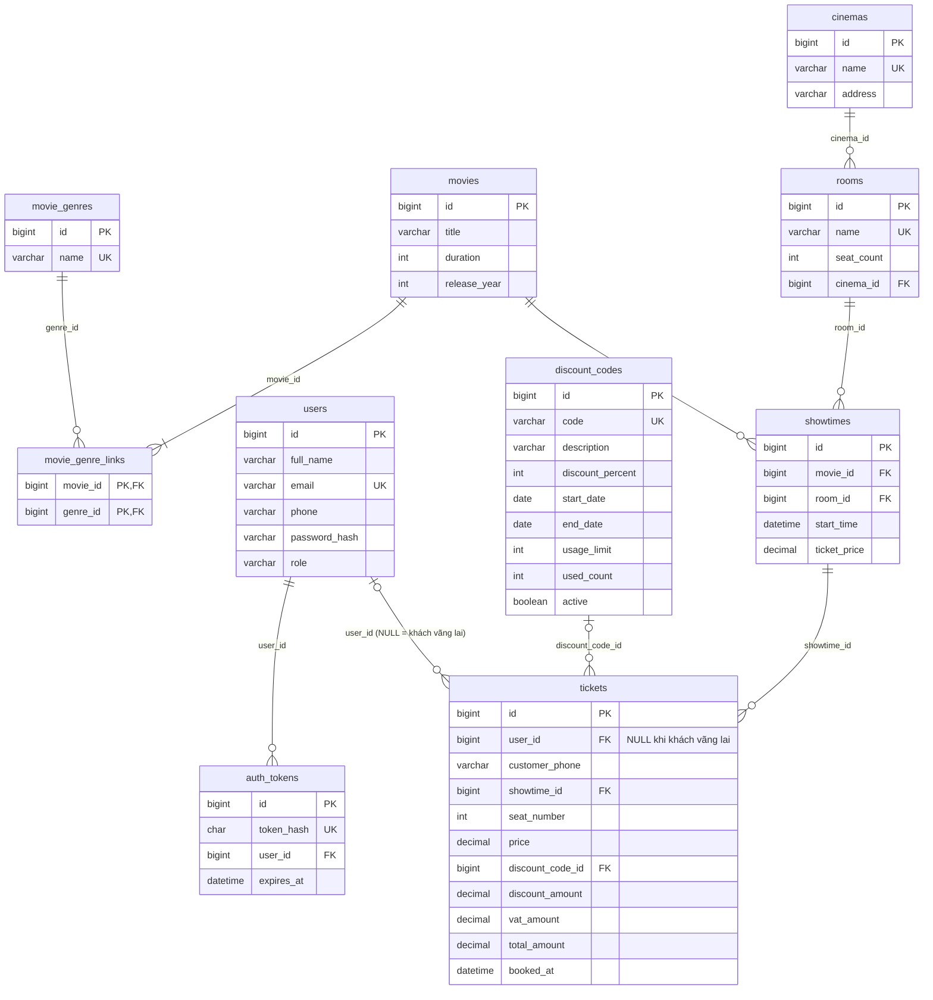

# ERD — Movie Store (10 bảng)

Ràng buộc nổi bật: `UNIQUE(showtime_id, seat_number)` trên `tickets`; khóa ngoại `ON DELETE RESTRICT`; `CHECK(user_id IS NOT NULL OR customer_phone IS NOT NULL)` trên `tickets`.
